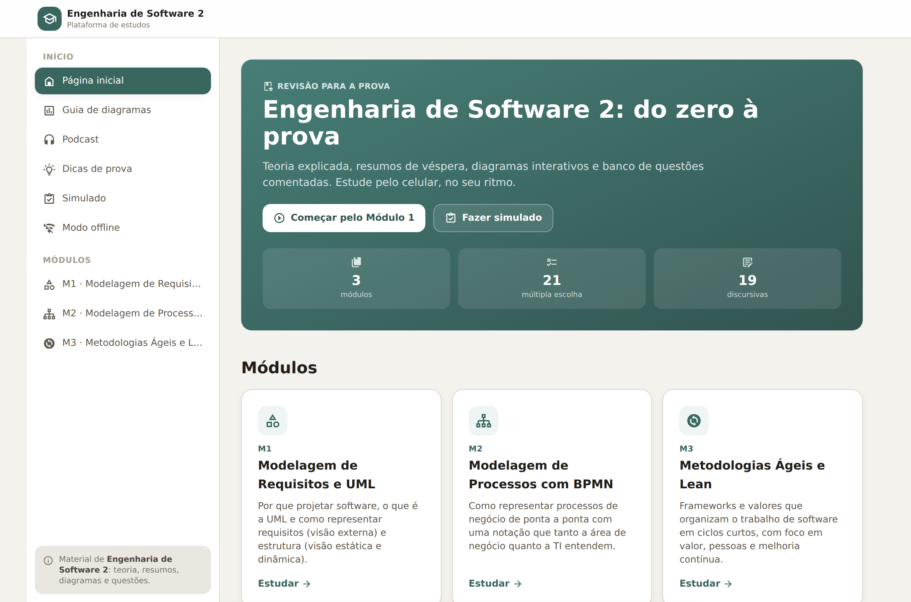
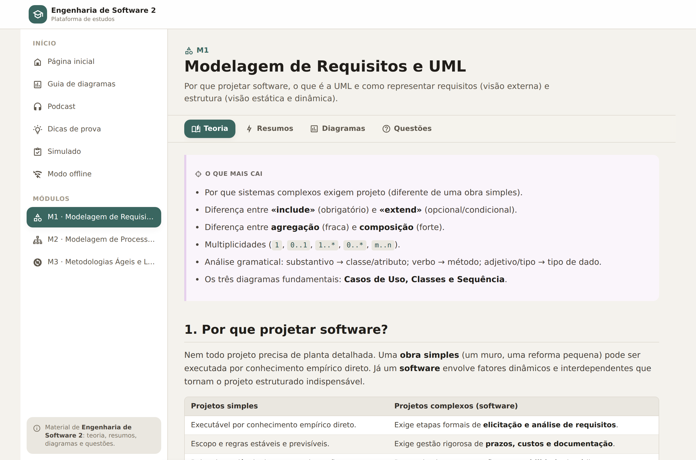
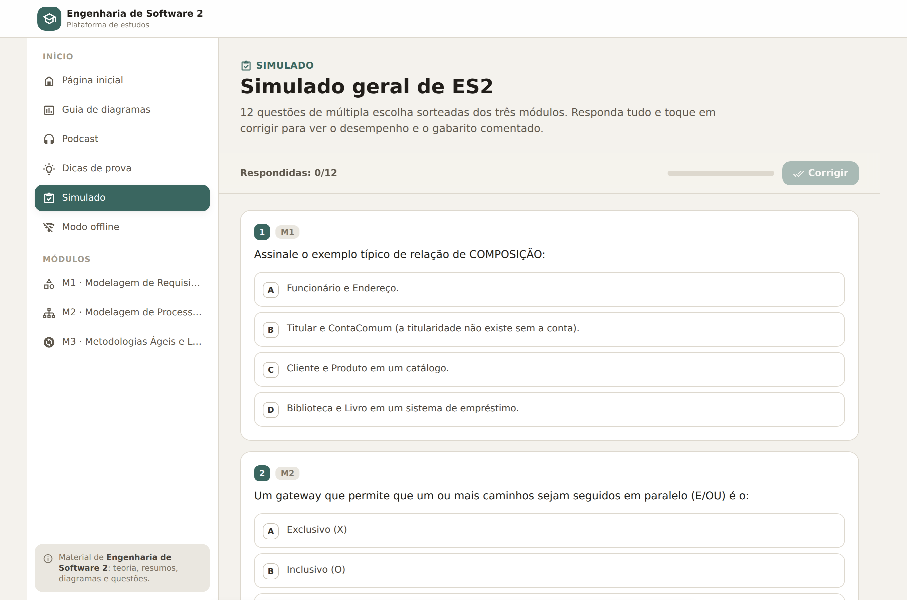
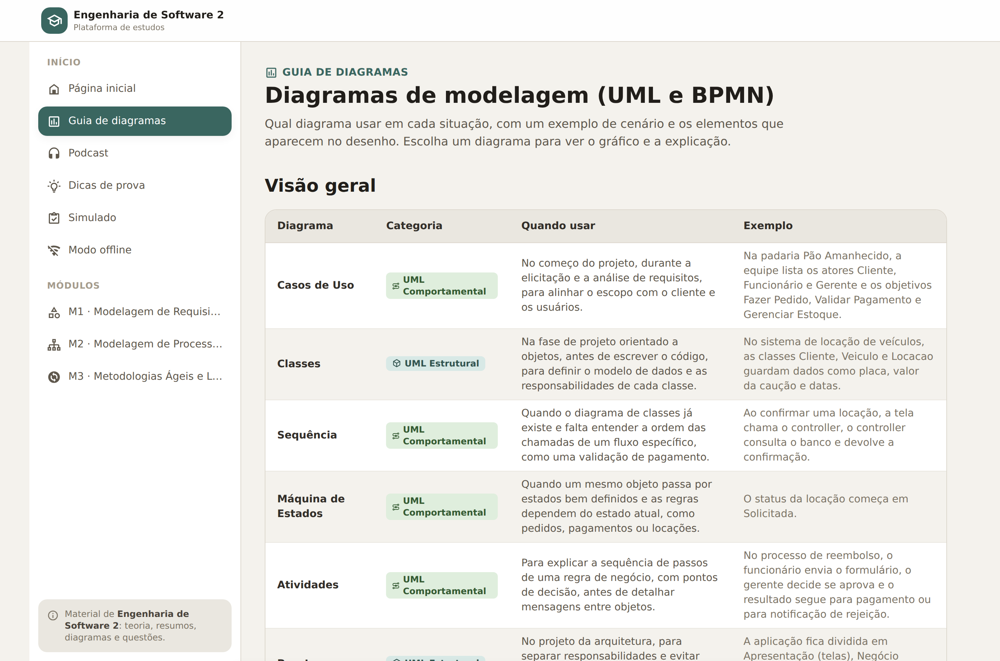
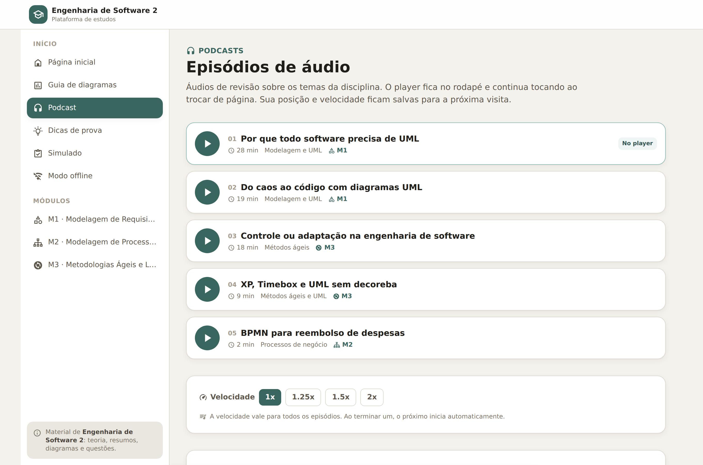

# ES2 · Plataforma de Estudos de Engenharia de Software 2

[](https://es2-estudos.pages.dev/)


[](LICENSE)

Site de revisão para a prova de **Engenharia de Software 2**: teoria explicada,
resumos de véspera, diagramas UML/BPMN interativos, banco de questões comentadas
e podcast de revisão. Tudo roda no navegador, sem backend, e funciona **offline**
(instalável como app no celular).

**Acesse: <https://es2-estudos.pages.dev/>**



## Capturas de tela

| Módulo (teoria, resumos, diagramas, questões) | Simulado |
| --- | --- |
|  |  |

| Guia de diagramas | Podcast |
| --- | --- |
|  |  |

## O que tem

- **3 módulos** — Modelagem de Requisitos e UML, Modelagem de Processos com
  BPMN e Metodologias Ágeis e Lean, cada um com abas de **Teoria**, **Resumos**,
  **Diagramas** e **Questões**.
- **Banco de questões** — 21 de múltipla escolha e 19 discursivas, com
  gabarito comentado e justificativa.
- **Simulado** — 12 questões sorteadas dos três módulos, correção com
  desempenho e gabarito.
- **Guia de diagramas** — 9 diagramas (Casos de Uso, Classes, Sequência,
  Máquina de Estados, Atividades, Pacotes, Componentes, Implantação e BPMN)
  com exemplo de cenário, elementos e o gráfico renderizado ao vivo com Mermaid.
- **Podcast** — 5 episódios de áudio, player fixo no rodapé que continua
  tocando ao trocar de página, velocidade 1x–2x e posição salva para a próxima
  visita.
- **Dicas de prova** e **modo offline** — service worker (Workbox) deixa o site
  instalável e navegável sem internet; o aviso de instalação aparece uma vez e
  pode ser dispensado.
- **Sem login, sem servidor** — o progresso do podcast fica no `localStorage`
  do próprio aparelho.

## Stack

| Camada | Ferramentas |
| --- | --- |
| Front-end | React 19, React Router 7 |
| Build | Vite 8 + `@vitejs/plugin-react` |
| Estilo | Tailwind CSS 3 + PostCSS/Autoprefixer |
| Conteúdo | Mermaid (diagramas), Iconify (ícones), markdown próprio em `src/data` |
| Áudio | `react-h5-audio-player` + contexto global (`AudioProvider`) |
| PWA | `vite-plugin-pwa` (Workbox) — cache de app, áudios e ícones |
| Lint | Oxlint (`npm run lint`) |

## Estrutura

```
es2-estudos/
├── docs/screenshots/        # imagens usadas neste README
├── public/                  # favicon, logo e ícones do PWA
├── scripts/build-icons.mjs  # gera src/data/icons.js a partir do bundle de ícones
├── src/
│   ├── assets/audio/        # os 5 episódios .m4a (~40 MB, versionados)
│   ├── components/          # Layout, Content, Quiz, Mermaid, MiniPlayer, PwaNotice…
│   ├── data/                # conteúdo dos módulos, guia de diagramas e ícones
│   ├── lib/                 # contexto de áudio e progresso do podcast
│   ├── pages/               # Home, ModulePage, Simulado, Diagramas, Podcast…
│   ├── App.jsx              # rotas
│   └── index.css            # tema (Tailwind)
├── index.html
└── vite.config.js           # plugins + configuração do service worker
```

### Rotas

`/` · `/modulo-1` · `/modulo-2` · `/modulo-3` · `/diagramas` · `/simulado` ·
`/podcast` · `/dicas` · `/offline`

## Rodando localmente

```bash
npm install     # dependências
npm run dev     # servidor de desenvolvimento (vite)
npm run build   # gera dist/
npm run preview # serve o build de produção
npm run lint    # oxlint
npm run icons   # regenera src/data/icons.js
```

## Deploy

O site é publicado na **Cloudflare Pages** a partir do GitHub
(<https://es2-estudos.pages.dev/>):

| | |
| --- | --- |
| Build command | `npm run build` |
| Output directory | `dist` |
| SPA | o `navigateFallback` do service worker leva todas as rotas para `index.html` |

## Notas

- Os áudios do podcast (~40 MB) ficam em `src/assets/audio/` e são versionados
  de propósito: assim o clone é autocontido e o player não depende de
  servidor externo. Se você só quer o código, use `git clone --depth 1`
  (mesmo assim os arquivos atuais vêm no download).
- Todo o conteúdo de estudo vive em `src/data/*.js` como objetos — editar
  teoria, questões ou diagramas não exige tocar em componente.

## Licença

[MIT](LICENSE) © odilklein

> Material de estudo **não oficial** da disciplina de Engenharia de Software 2.
